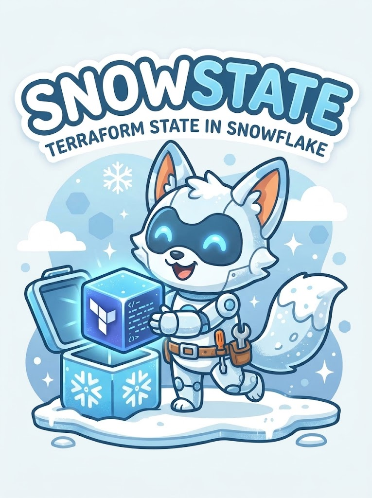
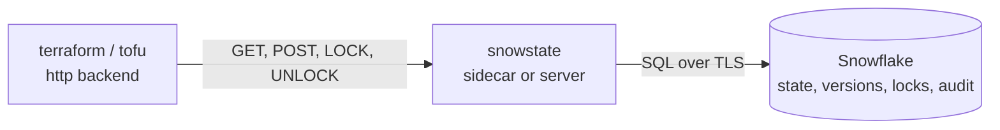

<p align="center">
  
</p>

<h1 align="center">snowstate</h1>

<p align="center">
  <strong>Keep your Terraform and OpenTofu state in Snowflake, with real locking and full history.</strong>
</p>

<p align="center">
  <a href="https://github.com/thunter/snowstate/actions/workflows/ci.yml"></a>
  <a href="LICENSE"></a>
  <a href="go.mod"></a>
</p>

> [!WARNING]
> **Very, very alpha.** Statey is doing his best, but he hasn't been out in a real blizzard yet. Don't use snowstate for
> production state, and expect breaking changes before v1.0. If something breaks, please
> [raise an issue](https://github.com/thunter/snowstate/issues/new).

Terraform needs somewhere safe to keep its state, and if your organisation already runs on Snowflake, that usually means
standing up a separate bucket, a lock table and another set of credentials just for this one job.

**snowstate lets you use the platform you already have.** It stores state, version history, locks and an audit trail in
ordinary Snowflake tables, secured by the roles and grants you already manage. Terraform and OpenTofu have no Snowflake
backend, and neither supports third-party backend plugins in a stable release, so snowstate speaks their built-in `http`
backend. That means no fork, no plugin and no wrapper around your modules.

You don't even need to host anything: `snowstate exec` runs a temporary local backend for the length of a single command.

## Why use snowstate?

- **One platform for your data and your state.** Use Snowflake's access control, encryption and retention, rather than
  adding another cloud service to secure and audit.
- **Nothing to run.** Sidecar mode needs no server. In GitHub Actions it can log in with workload identity, so there is no
  stored Snowflake secret.
- **Mistakes are recoverable.** Every write is kept as an immutable version, so you can go back to the state from before
  things went wrong.
- **Your infrastructure becomes queryable.** See what Terraform manages across every state with plain SQL.
- **It's just Snowflake.** Everything lives in tables you can inspect, back up and audit yourself.

## Features

| | |
|---|---|
| 🔒 **Race-free locking** | A hybrid table's enforced primary key decides every lock. In testing, 25 clients raced for one lock over 10 rounds, with exactly one winner each time. |
| 🕰️ **Full version history** | List, download and restore any version. A restore creates a new version, so history is never rewritten. |
| ✅ **Byte-exact storage** | State is stored exactly as received and checked against its MD5 on every read. |
| 🧩 **Works with stock tools** | Tested on Terraform 1.5 and 1.17 and OpenTofu 1.13, using only the built-in `http` backend. |
| 🚀 **Two ways to run** | A short-lived sidecar with `snowstate exec`, or a shared server with `snowstate serve`, from a single binary. |
| 🔍 **SQL inventory** | The `STATE_RESOURCES` view lists managed resources, and leaves out attributes because they can hold secrets. |
| 🧾 **Audit trail** | Every change is recorded in the same transaction as the change itself, and GitHub Actions runs are linked to their run URL. |
| 🔑 **Flexible auth** | Connect to Snowflake with key pair, PAT, OAuth, browser SSO or workload identity. Clients use scoped API tokens or mTLS. |
| 🐙 **Built for CI** | A GitHub Action, step summaries, and saved plans that work across jobs. |
| 🩺 **Operator tooling** | `migrate`, `doctor`, retention and cleanup with `gc`, Prometheus metrics and structured logs. |

## How it works



Terraform talks HTTP to snowstate, and snowstate reads and writes Snowflake. Your Terraform code doesn't change, apart from
the backend block.

## Project status

snowstate is **alpha and pre-1.0**, so expect rough edges, and try it somewhere safe before trusting it with production state.

- Hybrid tables are required for production locking. They are generally available on AWS and Azure, and in preview on GCP.
- `schema_per_project` tenancy is not ready: it has a known login failure, and its role isolation has not been verified.

[`docs/decisions.md`](docs/decisions.md) records what has been verified, and what has not.

## Install

Download a binary from [the latest release](https://github.com/thunter/snowstate/releases/latest) and check it. Binaries
are available for Linux, macOS and Windows, on amd64 and arm64.

```bash
asset=snowstate_linux_amd64   # or snowstate_linux_arm64, snowstate_darwin_amd64, snowstate_darwin_arm64
base=https://github.com/thunter/snowstate/releases/latest/download
curl -fsSLO "$base/$asset"
curl -fsSLO "$base/checksums.txt"
sha256sum --check --ignore-missing checksums.txt   # on macOS: shasum -a 256 --check --ignore-missing checksums.txt
chmod +x "$asset"
sudo mv "$asset" /usr/local/bin/snowstate
```

There is also a container image for `snowstate serve`, and a GitHub Action:

```bash
docker pull ghcr.io/thunter/snowstate:v0
```

```yaml
- uses: thunter/snowstate/action/setup@v0
```

To build from source, you need Go 1.27:

```bash
make build     # writes bin/snowstate
export PATH="$PWD/bin:$PATH"
```

## Quick start: sidecar

The sidecar runs a local server for the length of one command, using your own Snowflake credentials.
[The tutorial](docs/tutorial-snowflake-database.md) walks through this in full, from an empty account.

**1. [Install snowstate](#install).**

**2. Seed the account, once.** This creates `SNOWSTATE_SEED`, the identity the next step starts from:

```bash
openssl genrsa 2048 | openssl pkcs8 -topk8 -nocrypt -out ~/.snowflake/keys/snowstate_seed.p8
openssl rsa -in ~/.snowflake/keys/snowstate_seed.p8 -pubout -out snowstate_seed.pub
snowstate seed --public-key-file snowstate_seed.pub > seed.sql   # an admin runs seed.sql as ACCOUNTADMIN
```

**3. Create an Install.** This applies the Foundation with Terraform, runs `migrate` and `doctor`, and moves the Foundation's
own state into snowstate. It shows you the plan first:

```bash
export SNOWSTATE_SNOWFLAKE__ACCOUNT=myorg-myaccount
export SNOWSTATE_SNOWFLAKE__PRIVATE_KEY_PATH=~/.snowflake/keys/snowstate_seed.p8
snowstate install --database TF_STATE
```

Then, as the Seed role, grant `TF_STATE_SVC` to the people and service users who run Terraform, with
`GRANT ROLE TF_STATE_SVC TO USER ME;`. The role, warehouse, database and schema default to a `TF_STATE` Install, so each of
them only needs:

```bash
export SNOWSTATE_SNOWFLAKE__ACCOUNT=myorg-myaccount
export SNOWSTATE_SNOWFLAKE__USER=ME
export SNOWSTATE_SNOWFLAKE__PRIVATE_KEY_PATH=~/.snowflake/keys/me.p8
```

Laptop users can set `SNOWSTATE_SNOWFLAKE__AUTH=externalbrowser` instead of a key. `snowstate doctor` warns if your
session also has other roles, because it then can't prove what `TF_STATE_SVC` alone can do. For a service user, fix that
with `ALTER USER <name> SET DEFAULT_SECONDARY_ROLES = ();`.

**4. Point a module at it.** The backend block stays empty:

```hcl
terraform {
  backend "http" {}
}
```

**5. Run Terraform through the sidecar.**

```bash
export SNOWSTATE_KEY=platform/network/prod
snowstate exec -- terraform init
snowstate exec -- terraform apply
```

## Quick start: server

```bash
export SNOWSTATE_TOKEN_PEPPER="$(openssl rand -base64 48)"   # keep this stable and secret
snowstate token create --principal ci-platform --scope 'platform/*:read,write,lock' --expires 90d
snowstate serve --config snowstate.yaml
```

```hcl
terraform {
  backend "http" {
    address        = "https://snowstate.example.com/v1/states/platform/network/prod"
    lock_address   = "https://snowstate.example.com/v1/states/platform/network/prod"
    unlock_address = "https://snowstate.example.com/v1/states/platform/network/prod"
    username       = "ci-platform"   # the token goes in TF_HTTP_PASSWORD
  }
}
```

Keys are `<prefix>/<workspace>`. The http backend has no workspace support, so each workspace gets its own address, and
the default workspace is the literal segment `default`: `platform/network/default`.

## Documentation

| | |
|---|---|
| [Tutorial](docs/tutorial-snowflake-database.md) | Create a database with the Snowflake provider, with state in Snowflake |
| [CLI reference](docs/cli-reference.md) | Every command and flag, with examples |
| [Operator guide](docs/operator-guide.md) | Bootstrap, deployment, TLS, tokens, retention, cost, upgrades |
| [GitHub Actions](docs/github-actions.md) | Workload identity, the setup action, plan and apply across jobs |
| [Runbook](docs/runbook.md) | Stuck locks, outages, bad states, key rotation, recovering or removing an Install |
| [Decisions](docs/decisions.md) | Every verified behaviour and every deviation from the spec |
| [Example config](snowstate.example.yaml) | Every configuration key |
| [Examples](examples) | Module and CI examples |

## Contributing

Contributions are welcome. See [`CONTRIBUTING.md`](CONTRIBUTING.md) to get started, and [`SECURITY.md`](SECURITY.md) to
report a vulnerability privately.

```bash
make lint test     # unit tests, no network
make e2e           # real Terraform and OpenTofu against a memory store
make integration   # real Snowflake; needs SNOWSTATE_IT_*, skipped otherwise
```

## License

Apache-2.0. See [`LICENSE`](LICENSE).

*Statey the snowfox keeps your state safe.* 🦊❄️
